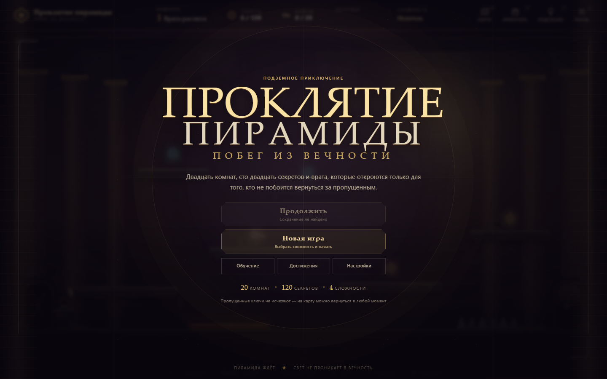
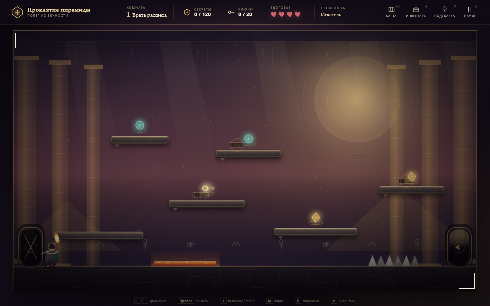
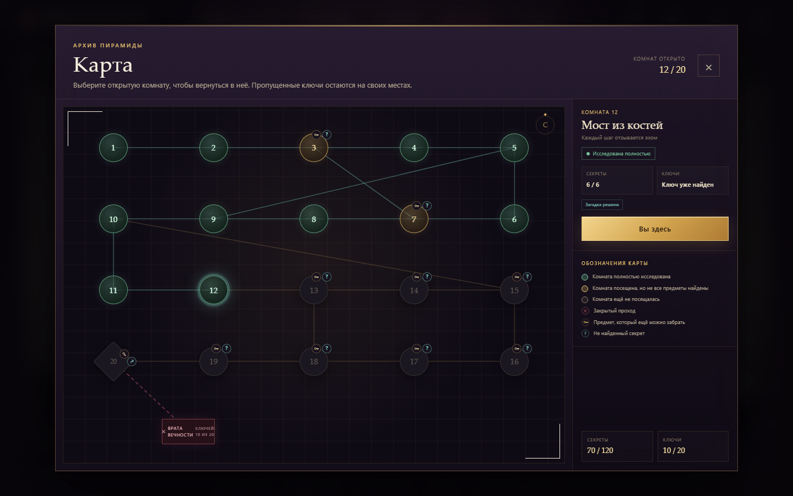
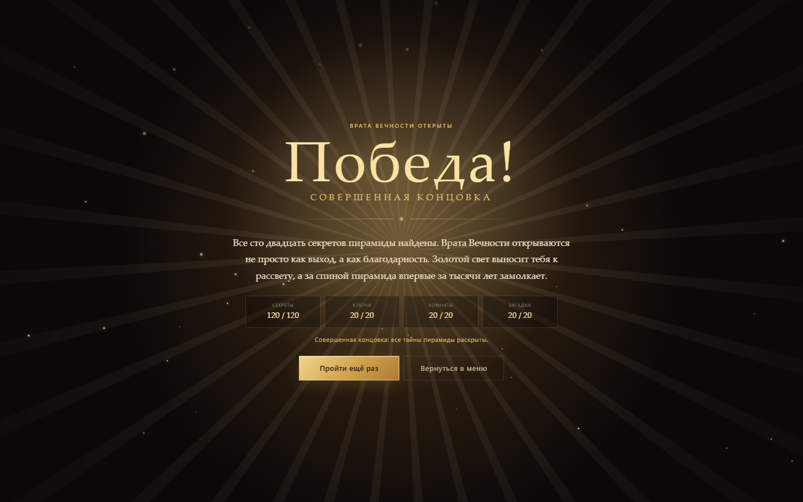
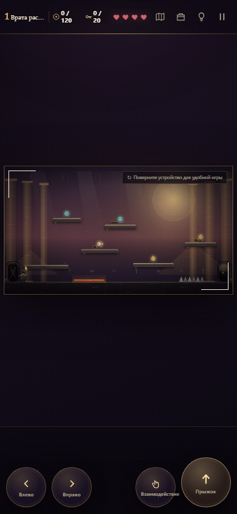
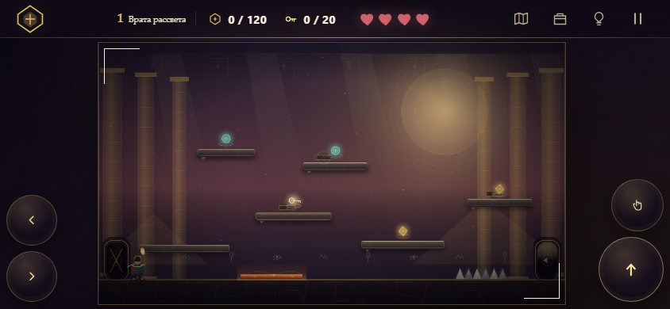

# Проклятие пирамиды: Побег из вечности

Браузерная приключенческая игра: двадцать комнат, сто двадцать секретов, четыре уровня сложности, интерактивная карта и полноценное сенсорное управление. Весь пользовательский интерфейс — на русском языке.

## Запуск

Проект не требует сборки и внешних зависимостей. Достаточно открыть папку через любой статический сервер:

```powershell
python -m http.server 4173 --bind 127.0.0.1
```

Затем откройте:

```text
http://127.0.0.1:4173
```

Для игры нужен современный браузер с поддержкой холста, событий указателя и локального хранилища. Прогресс сохраняется автоматически в `localStorage`; в паузе доступна и ручная кнопка «Сохранить игру».

## Скриншоты













## Управление

### Компьютер

| Действие | Клавиша |
|---|---|
| Движение | Стрелки влево и вправо |
| Прыжок | Пробел |
| Взаимодействие | Стрелка вверх или Enter |
| Карта | М или русская М |
| Подсказка | H или русская П |
| Инвентарь | I или русская И |
| Пауза | P, Esc или русская К |

В воздухе доступен второй прыжок. Удерживайте направление, чтобы бежать непрерывно.

### Смартфоны и планшеты

- Нижний левый угол — движение влево и вправо.
- Нижний правый угол — прыжок и взаимодействие.
- Верхняя панель — карта, инвентарь, подсказка и пауза.
- Кнопки обрабатывают события указателя и поддерживают несколько одновременных касаний.
- В горизонтальной ориентации кнопки вынесены по бокам, чтобы не перекрывать сцену.
- В вертикальной ориентации панель управления находится под сценой; прокрутка страницы заблокирована.

## Ключевая механика: возвращение

Игра устроена так, чтобы исключить безвыходные ситуации:

- все двадцать комнат остаются доступными после первого посещения;
- карта позволяет вернуться в любую посещённую комнату;
- незабранные ключи, реликвии и тайники остаются на своих местах;
- собранные предметы не создаются повторно;
- состояние каждой комнаты хранится отдельно: предметы, печати, загадки, посещение;
- решённые загадки и открытые проходы не сбрасываются;
- смерть и возрождение не отнимают инвентарь;
- перезагрузка браузера восстанавливает комнату, инвентарь, сложность и состояние загадок;
- финальные врата требуют двадцать ключей, но любой пропущенный ключ всегда можно найти на карте и забрать;
- встроенный валидатор проверяет, что все обязательные ключи либо уже в инвентаре, либо физически доступны в своей комнате.

Каждая комната содержит шесть секретов: один ключ, две реликвии и три тайника. Один тайник открывается после активации трёх печатей. Все двадцать ключей вместе с сотней реликвий и тайников дают ровно 120 секретов.

## Карта

Карта показывает все двадцать комнат и связи между ними:

- зелёная комната — исследована полностью;
- жёлтая — посещена, но не все предметы найдены;
- серая — ещё не посещалась;
- красная пунктирная линия и замок — закрытый финальный проход;
- значок ключа — ключ ещё можно забрать;
- знак вопроса — остались ненайденные секреты.

Коснитесь открытой комнаты, чтобы увидеть подробности, и нажмите «Вернуться в комнату».

## Сложности

1. **Странник** — пять сегментов здоровья, одна единица урона.
2. **Искатель** — четыре сегмента здоровья, одна единица урона.
3. **Хранитель** — три сегмента здоровья, две единицы урона.
4. **Проклятый** — два сегмента здоровья, две единицы урона.

Маршрут, комнаты и секреты одинаковы на всех сложностях. Каждая сложность проверена автоматическим сквозным прохождением.

## Автоматические тесты

```powershell
npm test
```

Если менеджер пакетов недоступен, те же тесты запускаются напрямую:

```powershell
node --test --test-isolation=none "tests/*.test.js"
```

Набор включает 46 автоматических тестов:

- `tests/tdd-core.test.js` — возвращение за ключом, сохранение состояния комнат, загадки, дубли, 20 доступных комнат;
- `tests/playthrough.test.js` — сквозное прохождение всех четырёх сложностей и сценарий с намеренным пропуском ключей в комнатах 2, 5, 9, 13 и 17;
- `tests/localization.test.js` — отсутствие латиницы во всех видимых надписях, названиях комнат, предметов, подсказках, сообщениях и финалах;
- `tests/app-localization.test.js` — проверка динамических строк приложения;
- `tests/dom-contract.test.js` — наличие всех экранов, элементов и сенсорных кнопок;
- `tests/controls.test.js` — одновременные касания, удержание, отпускание, движение и прыжок;
- `tests/content.test.js` — 20 комнат, 120 уникальных секретов, четыре сложности, карта и финальные врата;
- `tests/reachability.test.js` — физическая достижимость каждого предмета и каждой печати по уступам.

### Браузерная проверка

В папке `scripts/` находятся дополнительные сценарии для Chrome с отладочным портом. Они проверяют реальную сцену, клавиатуру, касания, карту, сохранение после перезагрузки, смерть, возрождение и финальные врата. Интерфейс отладочного режима доступен только по адресу `?debug=1`.

## Структура

```text
index.html              разметка экранов и сцены
css/styles.css          оформление, адаптивность, сенсорные элементы
src/content.js          20 комнат, 120 предметов, сложности, достижения
src/texts.js            словарь пользовательских текстов
src/game.js             состояние, сохранения, защита от тупиков
src/player.js           физика персонажа
src/touch-controls.js   указатели, клавиатура, мультитач
src/renderer.js         отрисовка сцены на холсте
src/app.js              связующая логика и экраны
tests/                  автоматические тесты
```

## Приёмка

- [x] Можно вернуться во все 20 ранее посещённых комнат.
- [x] Незабранные ключи остаются в комнатах.
- [x] Незабранные секреты остаются доступными.
- [x] Можно вернуться за предметом, необходимым для открытия финальных врат.
- [x] Уже собранные предметы не дублируются.
- [x] Состояние каждой комнаты сохраняется отдельно.
- [x] Возвращение работает после перезагрузки браузера.
- [x] Невозможно создать необратимую тупиковую ситуацию из-за пропущенного предмета.
- [x] Работает сенсорное управление на смартфонах и планшетах.
- [x] Можно одновременно двигаться и прыгать.
- [x] Кнопки адаптируются к размеру и ориентации экрана.
- [x] Весь пользовательский интерфейс, подсказки и уведомления на русском языке.
- [x] Автоматическая проверка русификации проходит.
- [x] Все четыре сложности полностью проходимы.
- [x] В игре 20 комнат, 120 секретов и эффектная совершенная концовка.
